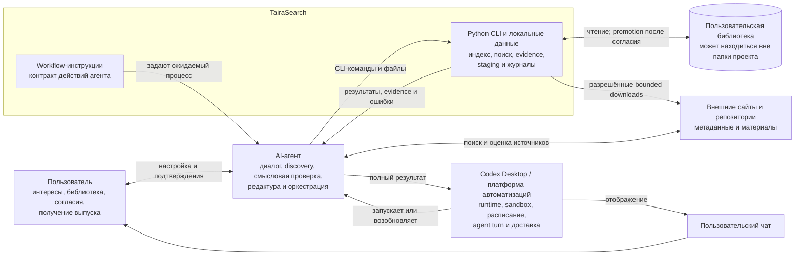
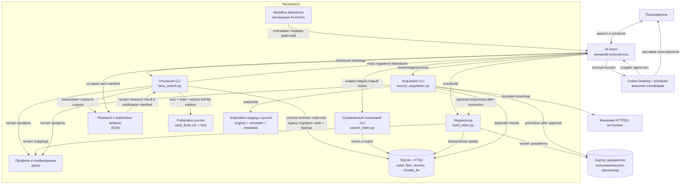
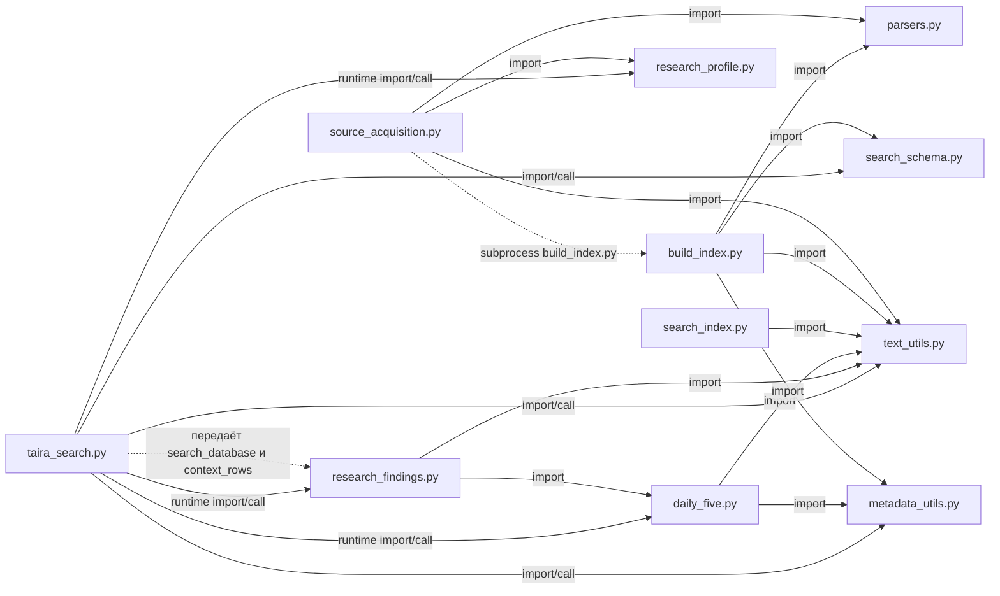

# Архитектура TairaSearch (AS IS)

## 1. Назначение и правила чтения

Документ фиксирует архитектуру ветки `main` на коммите `5a8378a`. Диаграммы
используют GitHub-compatible Mermaid `flowchart`. Термин «контейнер» применяется
в смысле C4: исполняемая или хранилищная часть системы, а не Docker-контейнер.
TairaSearch развёртывается как локальный модульный Python-проект.

Требования и пользовательские сценарии описаны в
[системном описании](system-overview.ru.md).

## 2. Архитектурные принципы

1. **Локальное Python-ядро.** Оно разбирает документы, индексирует, ищет,
   формирует структурированные свидетельства и безопасно ведёт журналы.
2. **Редакционная ответственность агента.** AI-агент интерпретирует смысл,
   проверяет атрибуцию и новизну, выбирает материалы и пишет карточки.
3. **Файловые контракты.** Основные способы взаимодействия — CLI, SQLite, JSON,
   CSV, каталоги и stdout.
4. **Раздельные разрешения.** Scan, индексация, download, promotion, публикация
   и расписание согласуются отдельно.
5. **Восстановимая публикация.** Точный текст сохраняется в манифесте до
   регистрации и может быть повторно выведен без нового исследования.
6. **Внешнее выполнение расписания.** Codex Desktop или другая платформа создаёт
   agent turn, предоставляет runtime и доставляет ответ; Python этого не делает.

Основание: [README](../../README.ru.md), [AGENTS.md](../../AGENTS.md),
[publication API](../../daily_five.py#L1149).

## 3. C4 Level 1 — System Context

### 3.1. Граница ответственности

- Discovery внешних источников выполняет агент. Python получает уже
  подготовленный манифест и проверяет URL, лимиты и дубли
  ([`validate_public_download_target`](../../source_acquisition.py#L194)).
- Workflow-инструкции входят в поставку TairaSearch как контракт процесса, но
  выполняются внешним агентом.
- Пользовательская библиотека не обязана лежать внутри проекта. Индекс хранит её
  `corpus_root` и отклоняет незаметное переподключение к другой папке
  ([`validate_index_corpus_root`](../../build_index.py#L83)).
- Python подтверждает подготовку и регистрацию, но не доставку в чат
  ([`publication_status_from_json`](../../daily_five.py#L1212)).

## 4. C4 Level 2 — Container

### 4.1. Контейнеры

| Контейнер | Технология | Ответственность |
| --- | --- | --- |
| Основной CLI | Python 3.11, `argparse`, `sqlite3` | Search/context, research-пакеты, проверка publication access, регистрация и rendering. |
| Сохранённый поисковый CLI | Python, `sqlite3` | Ранее реализованный поиск, ranking, diversification и export; поддерживается параллельно с основным CLI. |
| Индексатор | Python, SQLite WAL/FTS5, `pypdf` | Scan и транзакционное построение индекса. |
| Acquisition CLI | Python, `urllib`, файловая система | Валидация, bounded download, extraction, staging и promotion. |
| AI-агент | Внешний runtime | Интервью, discovery, смысловая проверка, редактура и вызовы CLI. |
| Платформа автоматизаций | Внешняя система | Среда выполнения, расписание, agent turn и доставка. |
| SQLite/FTS5 | Локальный файл | Производный поисковый индекс; актуальная схема читается CLI read-only, legacy-схема может мигрироваться отдельным записывающим путём. |
| JSON/CSV/каталоги | Локальные файлы | Профиль, настройки, evidence, recovery manifest, staging и журналы. |
| Корпус | Пользовательский каталог | Первичные документы; физически может находиться вне проекта. |

## 5. Внутренняя модульная схема Python

Легенда: сплошная стрелка — прямой import/call; пунктир — runtime-связь без
прямого импорта. Подпись пунктирной стрелки различает callback и subprocess.

### 5.1. Проверенные зависимости и архитектурные решения

- `research_findings.py` не зависит от `search_index.py`. Основной CLI передаёт
  ему свои `search_database` и `context_rows` как функции-параметры
  ([сигнатура](../../research_findings.py#L404),
  [вызов](../../taira_search.py#L927)).
- `search_index.py` не импортирует `search_schema.py`; это самостоятельный
  сохранённый поисковый интерфейс, работающий с SQLite и `text_utils.py`.
- `taira_search.py` — основной CLI для новых сценариев. `search_index.py`
  остаётся доступным ранее реализованным интерфейсом. Удаление или объединение
  в рамках AS IS не выполняется.
- В `daily_five.py` сосуществуют legacy-отбор, функции dedup и актуальный
  publication journal. Разделение модуля возможно как будущий рефакторинг, но
  текущее сосуществование не является дефектом само по себе.
- `source_acquisition.py` после отдельного согласия запускает `build_index.py`
  как subprocess, а не реализует второй индексатор
  ([вызов](../../source_acquisition.py#L1260)).

## 6. Ключевые взаимодействия

### 6.1. Подключение материалов

Есть три входа:

1. **Готовый индекс:** основной CLI проверяет актуальную схему read-only. Для
   legacy-схемы существует записывающая миграция с backup, которую onboarding
   требует отдельно согласовать.
2. **Документы без индекса:** сначала scan-only, затем отдельное согласие на
   построение SQLite.
3. **Нет материалов:** агент выполняет discovery, Python проверяет и помещает
   одобренные загрузки в staging, после второго согласия выполняются promotion и
   индексация.

Основание: [онбординг](../../docs/research-onboarding.ru.md).

### 6.2. Индексирование

1. Индексатор проверяет доступность корпуса.
2. До изменения существующей базы он read-only сверяет `corpus_root`.
3. Парсеры извлекают текст; утилиты нормализуют, делят и аннотируют фрагменты.
4. `files`, `chunks` и FTS обновляются в транзакционных границах.
5. Ошибка отдельного файла сохраняет его последнюю пригодную версию.

Основание: [`build_index`](../../build_index.py#L490),
[тесты](../../tests/test_incremental_safety.py#L92).

### 6.3. Исследование и редактура

1. `research-findings --preview` читает профиль, индекс и журнал.
2. Python создаёт полный результат и компактный editorial packet.
3. Агент классифицирует неоднозначные совпадения и выбирает финалистов.
4. `research-context` собирает полный контекст из сохранённого результата.
5. Агент пишет карточки и сохраняет точные ссылки на находки.

Python не подтверждает историческую достоверность редакционного текста.
Основание: [workflow](../../examples/codex/research-workflow.ru.md),
[реализация](../../research_findings.py#L404).

### 6.4. Публикация и восстановление

1. В scheduled environment выполняется `check-publication-access`.
2. Агент сохраняет финальный манифест.
3. `record-publication` проверяет структуру всех карточек.
4. Python получает межпроцессный lock, перечитывает CSV, формирует полный новый
   набор строк, пишет временный файл с `fsync` и заменяет журнал через
   `os.replace`.
5. `render-publication` выводит точный сохранённый Markdown после проверки ID.
6. Агент и платформа доставляют вывод в чат; Python этого не подтверждает.
7. При недоставке тот же манифест можно отобразить повторно.

Основание: [проверка доступа](../../taira_search.py#L444),
[атомарная замена](../../daily_five.py#L1321),
[блокировка](../../daily_five.py#L1340).

### 6.5. Acquisition

1. Агент находит кандидаты и формирует манифест.
2. `check` ищет дубли без загрузки.
3. После разрешения `stage` проверяет URL/DNS/редиректы и лимиты, сохраняет
   original, extracted text и metadata.
4. Пользователь отдельно подтверждает `source_id`, корпус и индекс.
5. `promote --approve` переносит данные; `--index` опционально запускает
   индексатор.

Первоначальное создание библиотеки и регулярное пополнение используют этот
механизм, но являются разными пользовательскими сценариями.

## 7. Развёртывание и эксплуатационная граница

Минимальное развёртывание — локальная папка проекта, Python 3.11, SQLite и
доступный корпус. Корпус может находиться в другом пользовательском каталоге.
Отдельного постоянно работающего Python-процесса нет.

Для регулярного выпуска внешняя платформа должна предоставить проект, рабочую
директорию, Python, права чтения SQLite/WAL и атомарной записи рядом с журналом,
создать настоящий agent turn и показать полный вывод `render-publication`.
Доступность инструментов в интерактивном чате не доказывает доступность
scheduled runtime.

## 8. AS IS и возможное развитие

| Область | AS IS | Возможное, но не утверждённое улучшение |
| --- | --- | --- |
| Поисковые CLI | `taira_search.py` основной; `search_index.py` сохранён | Сократить дублирование после отдельного решения |
| Идентичность | Позиционный `chunk_id` | Постоянный ID смысловой находки и миграция истории |
| Cleanup | Пропавшие документы сохраняются | Отдельное удаление с preview и подтверждением |
| Publication | `publication_id`, manifest, CSV journal | Более сложная модель жизненного цикла |
| Автоматизация | Codex Desktop как основная рассматриваемая платформа | Мониторинг запусков и доставки |
| Качество | Evidence workflow и синтетические тесты | Метрики на реальном корпусе |
| Эксплуатация | Локальные файлы и ручные recovery-контракты | Backup/retention и измеримые SLA |

BPMN, ERD, UML Sequence и спецификации интерфейсов намеренно не входят в этап.

