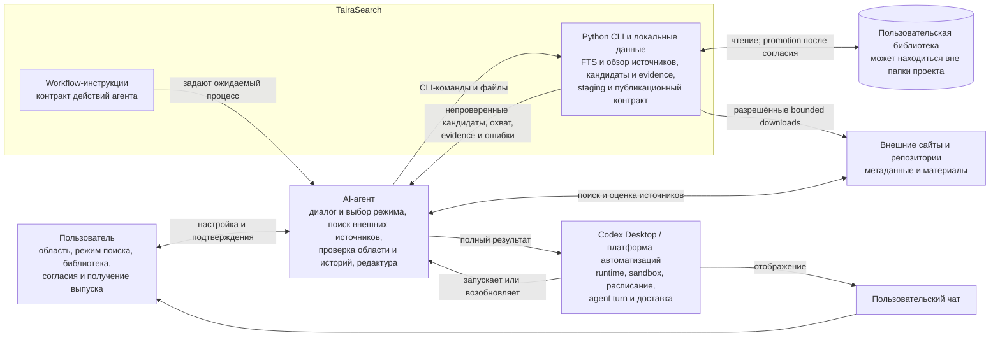
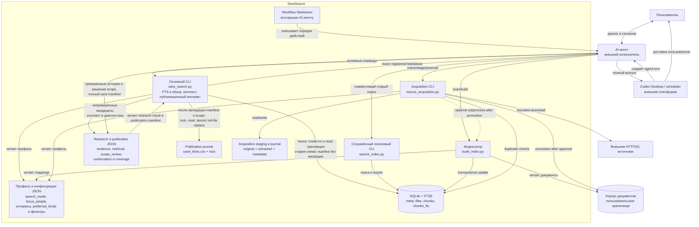
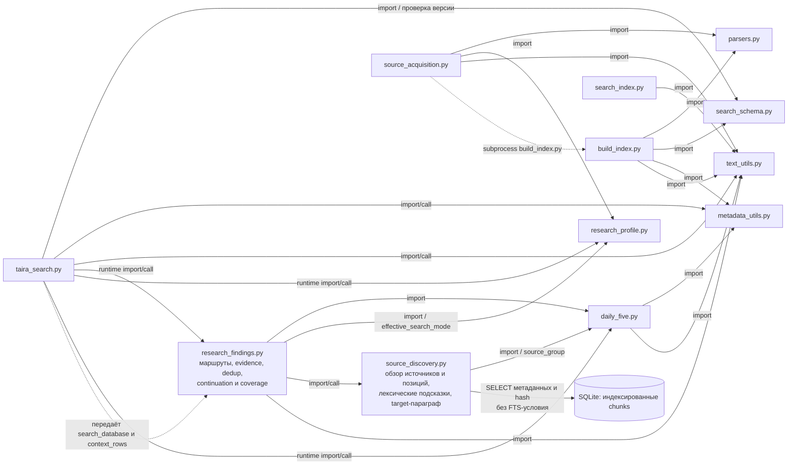

# Архитектура TairaSearch (AS IS)

## 1. Назначение и правила чтения

Документ фиксирует реализацию PR #12 в ветке `codex/source-balanced-discovery`
на коммите `6ae7ca6`. Диаграммы
используют GitHub-compatible Mermaid `flowchart`. Термин «контейнер» применяется
в смысле C4: исполняемая или хранилищная часть системы, а не Docker-контейнер.
TairaSearch развёртывается как локальный модульный Python-проект.

Требования и пользовательские сценарии описаны в
[системном описании](system-overview.ru.md).

## 2. Архитектурные принципы

1. **Локальное Python-ядро.** Оно разбирает документы, индексирует, ищет,
   формирует структурированные свидетельства и безопасно ведёт журналы.
2. **Разделение обнаружения и принятия.** Python даёт непроверенные кандидаты;
   AI-агент оценивает область, содержательную связь с выбранными людьми,
   атрибуцию, новизну, вид истории и редакционный интерес, затем пишет карточки.
3. **Файловые контракты.** Основные способы взаимодействия — CLI, SQLite, JSON,
   CSV, каталоги и stdout.
4. **Раздельные разрешения.** Scan, индексация, download, promotion, публикация
   и расписание согласуются отдельно.
5. **Восстановимая публикация.** Точный текст сохраняется в манифесте до
   регистрации и может быть повторно выведен без нового исследования.
6. **Внешнее выполнение расписания.** Codex Desktop или другая платформа создаёт
   agent turn, предоставляет runtime и доставляет ответ; Python этого не делает.
7. **Два маршрута обнаружения.** Тематический FTS дополнен обзором разрешённых
   источников, не требующим известных имён и терминов в открытом режиме.
8. **Поиск только для чтения.** Основной CLI не мигрирует старую схему;
   обновление индекса — отдельная согласованная операция.

Основание: [README](../../README.ru.md), [AGENTS.md](../../AGENTS.md),
[publication API](../../daily_five.py).

## 3. C4 Level 1 — System Context

### 3.1. Граница ответственности

- Поиск новых внешних источников выполняет агент. Python получает уже
  подготовленный манифест и проверяет URL, лимиты и дубли
  ([`validate_public_download_target`](../../source_acquisition.py)).
- Обзор уже индексированных источников выполняет Python. Совпадение алиаса в
  target-параграфе — технический допуск; содержательную связь с человеком и
  областью проверяет агент. Лексические подсказки не являются оценкой интереса.
- Workflow-инструкции входят в поставку TairaSearch как контракт процесса, но
  выполняются внешним агентом. Валидатор манифеста проверяет заявленный результат
  `scope_review`, не истинность решения и не цитаты по SQLite.
- Пользовательская библиотека не обязана лежать внутри проекта. Индекс хранит её
  `corpus_root` и отклоняет незаметное переподключение к другой папке
  ([`validate_index_corpus_root`](../../build_index.py)).
- Python подтверждает подготовку и регистрацию, но не доставку в чат
  ([`publication_status_from_json`](../../daily_five.py)).

## 4. C4 Level 2 — Container

### 4.1. Контейнеры

| Контейнер | Технология | Ответственность |
| --- | --- | --- |
| Основной CLI | Python 3.11, `argparse`, `sqlite3` | FTS и обзор в выбранном режиме, контекст/continuation/диагностика, publication access, валидация манифеста, регистрация и render. |
| Сохранённый поисковый CLI | Python, `sqlite3` | Ранее реализованный поиск, ranking, diversification и export; поддерживается параллельно с основным CLI. |
| Индексатор | Python, SQLite WAL/FTS5, `pypdf` | Scan и транзакционное построение индекса. |
| Acquisition CLI | Python, `urllib`, файловая система | Валидация, bounded download, extraction, staging и promotion. |
| AI-агент | Внешний runtime | Выбор/смена режима по согласию, внешние источники, проверка области и содержательных связей, редактура и CLI. |
| Платформа автоматизаций | Внешняя система | Среда выполнения, расписание, agent turn и доставка. |
| SQLite/FTS5 | Локальный файл | Производный индекс. Основной поисковый CLI читает его с WAL и отказывает при старой схеме; изменения выполняются отдельным путём индексирования/обновления. |
| JSON/CSV/каталоги | Локальные файлы | Профиль, настройки, evidence, recovery manifest, staging и журналы. |
| Корпус | Пользовательский каталог | Первичные документы; физически может находиться вне проекта. |

## 5. Внутренняя модульная схема Python

Легенда: сплошная стрелка — прямой import/call; пунктир — runtime-связь без
прямого импорта. Подпись пунктирной стрелки различает callback и subprocess.

### 5.1. Проверенные зависимости и архитектурные решения

- `source_discovery.py` вызывается из `research_findings.py`; читает метаданные
  `chunks` через то же SQLite-соединение, не вызывает LLM, не строит индекс и
  не загружает книги из сети. Полные targets/соседи получает оркестратор через
  callback `context_rows`. Это модуль внутри основного CLI, не новый сервис.
- `research_profile.py` валидирует явный режим, а `effective_search_mode`
  сохраняет legacy-политику без переписывания файла. `research_findings.py`
  использует результат при формировании кандидатов, а не только в инструкциях.

- `research_findings.py` не зависит от `search_index.py`. Основной CLI передаёт
  ему свои `search_database` и `context_rows` как функции-параметры
  ([сигнатура](../../research_findings.py),
  [вызов](../../taira_search.py)).
- `search_index.py` не импортирует `search_schema.py`; это самостоятельный
  сохранённый поисковый интерфейс, работающий с SQLite и `text_utils.py`.
- `taira_search.py` — основной CLI для новых сценариев. `search_index.py`
  остаётся доступным ранее реализованным интерфейсом. Удаление или объединение
  в рамках AS IS не выполняется.
- В `daily_five.py` сосуществуют legacy-отбор, функции dedup и актуальный
  publication journal. Разделение модуля возможно как будущий рефакторинг, но
  текущее сосуществование не является дефектом само по себе.
- `source_acquisition.py` после отдельного согласия запускает `build_index.py`
  как subprocess, а не реализует второй индексатор
  ([вызов](../../source_acquisition.py)).

## 6. Ключевые взаимодействия

### 6.1. Подключение материалов

Есть три входа:

1. **Готовый индекс:** основной CLI открывает read-only соединение с WAL,
   включает `query_only` и read-транзакцию. При старой схеме закрывает его и
   сообщает о необходимости отдельного обновления. Согласие пользователя само
   по себе не включает миграцию в поисковой команде.
2. **Документы без индекса:** сначала scan-only, затем отдельное согласие на
   построение SQLite.
3. **Нет материалов:** агент выполняет discovery, Python проверяет и помещает
   одобренные загрузки в staging, после второго согласия выполняются promotion и
   индексация.

Основание: [онбординг](../../docs/research-onboarding.ru.md).

### 6.2. Индексирование

1. Индексатор проверяет доступность корпуса.
2. До изменения существующей базы он read-only сверяет `corpus_root`.
3. Парсеры извлекают текст; утилиты нормализуют, делят и аннотируют фрагменты.
4. `files`, `chunks` и FTS обновляются в транзакционных границах.
5. Ошибка отдельного файла сохраняет его последнюю пригодную версию.

Основание: [`build_index`](../../build_index.py),
[тесты](../../tests/test_incremental_safety.py).

### 6.3. Исследование, режимы и обзор источников

1. `research-findings --preview` читает профиль, индекс и журнал. Явный
   `search_mode` — `open` или `focused_people`. Для нового персонального режима
   обязателен непустой `focus_people`; выбор и смена режима согласуются через
   агента, без переиндексации. Без поля сохраняется `include_unlisted_people`:
   `true` допускает открытый поиск; `false` ограничивает людьми, если они есть.
   Старый `false` с пустым списком сохраняет тематическое поведение.
2. Тематический маршрут использует `interests[].terms`, веса и FTS. Параллельно
   `source_exploration` инвентаризирует метаданные/hash разрешённых фрагментов.
   Сохраняются типы материалов, include/exclude источников, качество и технический
   dedup. Несколько `include_sources` действуют как AND по подстроке источника,
   исключение запрещает выдачу. `--discovery-path` дополнительно сужает только
   обзор по префиксам относительного пути (OR), не отменяя профиль.
3. Отдельные работы в `acquired/` группируются отдельно. Идентичные
   последовательности hash документов делят очередь, одинаковые фрагменты
   внутри группы не получают дополнительные ходы. Сначала обслуживаются менее
   представленные источники/документы. Позиции документа обходятся по серединам
   интервалов: середина, четверти, восьмые и далее, а не только от начала книги.
4. Слова `preferred_kinds` дают мягкие FTS-подсказки. Внутри документа их
   совпадения чередуются с позиционным обходом. Отсутствие лексического совпадения,
   в том числе между разными языками, не блокирует открытый обзор. Это не
   семантическая модель вида истории или оценка читательского интереса.
5. Маршруты чередуются и до загрузки контекста (`pool_size`), и в выданной партии
   (`batch_size`); состояние очереди сохраняется и для партий из одного элемента.
   Полный target/соседи читаются и проходят проверки контекста, читаемости и dedup.
   В `focused_people` нужен читаемый target-параграф с алиасом выбранного человека;
   одного имени у соседа недостаточно. Это ещё не доказательство смысловой связи.
6. Python сохраняет полный результат и компактный пакет: ID, источник, позицию,
   полный контекст, `retrieval` с причиной обнаружения, `scope_review: pending`,
   признаки повторов и диагностику. Без подтверждённого тематического совпадения
   `topics` может быть пустым, `primary_topic` — `null`. Поля `final`/`alternates`
   не означают редакционное принятие; сырой `retrieval_excerpt` не является новостью.
7. Агент запрашивает `research-context`, проверяет область и содержательную связь
   с человеком, атрибуцию и новизну, затем независимо принимает редакционное
   решение с учётом пожеланий к историям. Неподходящие/сомнительные связи не
   публикуются как принятые. После этого автор пишет карточки.

**Продолжение.** `--continue-from` исключает показанные ID и точные свёртки.
Дополнение состояния обзора содержит версию, следующий маршрут и отказы по
ID/hash. Неизменённый отказ не занимает обзорный бюджет вновь, но не блокирует
тематический путь; изменение hash возвращает допуск. Пригодные непоказанные
targets остаются доступны; соседи не считаются просмотренными targets. Другой
профиль, префиксы либо неизвестное/повреждённое состояние отклоняются. Между
вызовами база может обновляться; continuation не фиксирует её навсегда.

**Охват.** `coverage.retrieval_methods` считает checked/emitted по маршрутам,
с возможным пересечением ID. `coverage.discovery.sources` показывает доступные,
допущенные, ранее показанные, проверенные и выданные количества по путям, причины
фильтрации/пропуска и позиции выдачи; есть агрегаты групп и лексических попаданий.
Технические отказы видны также в `stats.rejected`. Инвентаризация метаданных
охватывает библиотеку, контексты ограничены пулом, выдача — партией. Ни один
выпуск не обещает каждую книгу или все сильные истории.

Основание: [оркестратор](../../research_findings.py),
[обзор](../../source_discovery.py), [профиль](../../research_profile.py),
[тесты](../../tests/test_source_discovery.py),
[workflow](../../examples/codex/research-workflow.ru.md).

### 6.4. Публикация и восстановление

1. В scheduled environment выполняется `check-publication-access`.
2. Агент сохраняет точные тексты и решения проверки области в манифесте;
   workflow требует для нового выпуска указать `search_mode` и имена людей.
3. `_load_publication_manifest` проверяет структуру. При наличии `search_mode`, отличного от `null`,
   принимает только `open`/`focused_people`; для каждой карточки требует
   `scope_review.status: accepted`, непустую строку `reason`, непустой список
   `evidence` с непустыми строками `chunk_id` и `quote`. При персональном режиме
   дополнительно требует непустой список строк-имён `focus_people` и
   `scope_review.focus_person`, входящий в него. `pending`/`uncertain`, пропуски
   и неподходящее имя отменяют регистрацию до lock и записи журнала.
4. Валидатор не загружает профиль, не сверяет цитаты с SQLite и не оценивает
   содержательную связь или истинность. Их проверяет агент; принятые поля
   манифеста являются контрактом его решения, а не независимой экспертизой Python.
5. После валидации всех карточек Python получает межпроцессный lock, перечитывает
   CSV, пишет полный новый набор строк во временный файл с `fsync` и атомарно
   заменяет журнал через `os.replace`.
6. `render-publication` проверяет наличие ID в журнале и выводит сохранённый
   Markdown. Агент и платформа показывают весь вывод; Python не подтверждает
   доставку или прочтение.
7. У манифеста без `search_mode` или с `null` сохраняется старый формат без новой
   обязательной проверки `scope_review`, в том числе при регистрации и render.
   Ранее подготовленные манифесты не переписывают; зарегистрированный выпуск
   восстанавливают из того же неизменного файла без поиска и новой регистрации.

Основание: [валидатор, lock и запись](../../daily_five.py),
[проверка доступа](../../taira_search.py),
[тест нового контракта](../../tests/test_source_discovery.py),
[тесты совместимости и восстановления](../../tests/test_publication_journal.py).

### 6.5. Acquisition

1. Агент находит кандидаты и формирует манифест.
2. `check` ищет дубли без загрузки.
3. После разрешения `stage` проверяет URL/DNS/редиректы и лимиты, сохраняет
   original, extracted text и metadata.
4. Пользователь отдельно подтверждает `source_id`, корпус и индекс.
5. `promote --approve` переносит данные; `--index` опционально запускает
   индексатор.

Первоначальное создание библиотеки и регулярное пополнение используют этот
механизм, но являются разными пользовательскими сценариями.

## 7. Развёртывание и эксплуатационная граница

Минимальное развёртывание — локальная папка проекта, Python 3.11, SQLite и
доступный корпус. Корпус может находиться в другом пользовательском каталоге.
Отдельного постоянно работающего Python-процесса нет.

Для регулярного выпуска внешняя платформа должна предоставить проект, рабочую
директорию, Python, права чтения SQLite/WAL и атомарной записи рядом с журналом,
создать настоящий agent turn и показать полный вывод `render-publication`.
Доступность инструментов в интерактивном чате не доказывает доступность
scheduled runtime.

## 8. AS IS и возможное развитие

| Область | AS IS | Возможное, но не утверждённое улучшение |
| --- | --- | --- |
| Поисковые CLI | `taira_search.py` основной; `search_index.py` сохранён | Сократить дублирование после отдельного решения |
| Идентичность | Позиционный `chunk_id` | Постоянный ID смысловой находки и миграция истории |
| Cleanup | Пропавшие документы сохраняются | Отдельное удаление с preview и подтверждением |
| Поиск | FTS и обзор, два режима, сохранённое продолжение | Семантическое ранжирование видов историй в Python не реализовано |
| Охват | Диагностика маршрутов/путей и ограниченные партии | Метрики полноты тематической и редакционной выборки |
| Publication | Режим и структурный `scope_review` для новых манифестов; legacy recovery сохранён | Более сложная модель жизненного цикла |
| Автоматизация | Codex Desktop как основная рассматриваемая платформа | Мониторинг запусков и доставки |
| Качество | Evidence workflow и синтетические тесты | Метрики на реальном корпусе |
| Эксплуатация | Локальные файлы и ручные recovery-контракты | Backup/retention и измеримые SLA |

BPMN, ERD, UML Sequence и спецификации интерфейсов намеренно не входят в этап.

