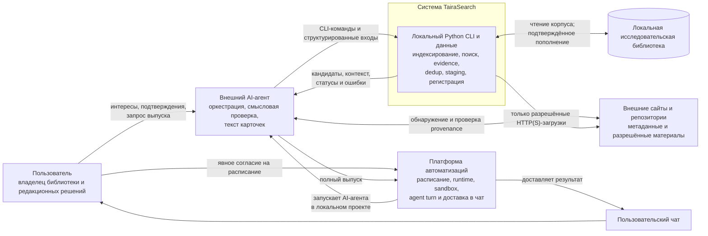
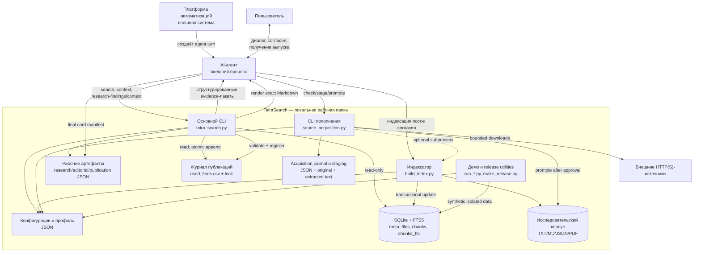
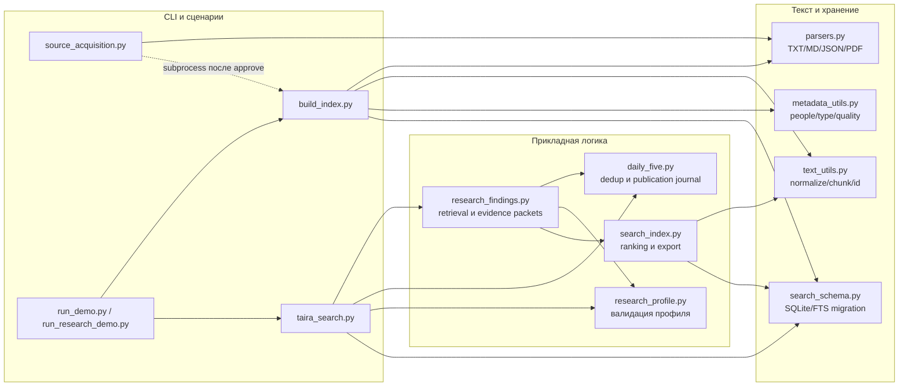

# Архитектура TairaSearch (AS IS)

## 1. Назначение и правила чтения

Документ фиксирует архитектуру ветки `main` на коммите `5a8378a`. Диаграммы
используют обычный Mermaid `flowchart`, совместимый с GitHub. Термин «контейнер»
ниже используется в смысле C4 (исполняемая или хранилищная часть), а не Docker.
TairaSearch — модульный локальный Python-проект, не распределённая система и не
набор микросервисов.

Системные требования и границы описаны в
[«Системном описании TairaSearch»](system-overview.ru.md).

## 2. Архитектурные принципы AS IS

1. **Локальное детерминированное ядро.** Python разбирает документы,
   индексирует, ищет, формирует структурированные свидетельства и безопасно
   ведёт журналы.
2. **Явная граница AI.** AI-агент интерпретирует смысл, проверяет нарратив и
   научную атрибуцию, принимает редакционное решение и пишет карточки. Python
   редакционный текст самостоятельно не генерирует.
3. **Файловая интеграция.** Компоненты обмениваются SQLite, JSON, CSV и stdout;
   собственного HTTP API, брокера сообщений или серверного процесса нет.
4. **Раздельные согласия.** Поиск, публикация, загрузка, продвижение в корпус и
   индексация имеют разные границы разрешения.
5. **Восстановимая публикация.** Точный текст сохраняется в манифесте до записи
   в журнал, а затем может быть повторно выведен без нового исследования.
6. **Планировщик внешний.** Репозиторий предоставляет workflow и проверки, но
   создание agent turn, sandbox и доставка в чат принадлежат платформе
   автоматизаций.

Основание: [README](../../README.ru.md),
[AI workflow](../../docs/ai-workflow.md),
[publication API](../../daily_five.py#L1149),
[onboarding contract](../../AGENTS.md).

## 3. C4 Level 1 — System Context

### 3.1. Пояснения к границе

- Веб-обнаружение кандидатов выполняет агент. Встроенный downloader получает
  только уже описанные в манифесте прямые URL и проверяет их безопасность
  ([`validate_public_download_target`](../../source_acquisition.py#L194)).
- Планировщик не является Python-модулем TairaSearch. Workflow-промпты задают
  правила вызова, но их исполнение зависит от внешней платформы.
- Python подтверждает подготовку и регистрацию выпуска, но возвращает
  `delivery: unconfirmed`; чат находится за системной границей
  ([`publication_status_from_json`](../../daily_five.py#L1212)).

## 4. C4 Level 2 — Container

### 4.1. Контейнеры и технологии

| Контейнер | Технология | Ответственность | Не выполняет |
| --- | --- | --- | --- |
| Основной CLI | Python 3.11, `argparse`, `sqlite3` | Search/context, research-пакеты, проверка publication access, регистрация и rendering | Не пишет редакционный текст, не создаёт расписание |
| Индексатор | Python, SQLite WAL/FTS5, `pypdf` | Сканирование и транзакционное построение индекса | Не выполняет смысловую экспертизу, не удаляет пропавшие документы |
| Acquisition CLI | Python, `urllib`, локальная ФС | Валидация, bounded download, extraction, staging, promotion | Не ищет сайты сам, не определяет юридический статус, не продвигает без согласия |
| AI-агент | Внешний runtime | Интервью, веб-обнаружение, смысловая проверка, редактура, оркестрация CLI | Не заменяет детерминированные журнальные операции |
| Платформа автоматизаций | Внешняя desktop/cloud-система | Расписание, окружение, sandbox, создание хода и доставка | Не входит в кодовую базу; её успех не следует из статуса Python |
| SQLite/FTS5 | Локальный файл | Производный индекс и полнотекстовый поиск | Не хранит тексты готовых карточек и расписания |
| JSON/CSV/каталоги | Локальные файлы | Профиль, конфигурация, evidence, publication recovery, журналы и staging | Не являются централизованной БД или API |

## 5. Внутренняя модульная схема Python

### 5.1. Наблюдения о связности

- `taira_search.py` — фасад нового пользовательского и агентского workflow, но
  часть поисковой логики остаётся в `search_index.py`.
- `daily_five.py` одновременно содержит legacy-сценарий отбора, общую логику
  сравнения повторов и актуальный publication journal. Это функционально
  подтверждено тестами, но увеличивает число причин для изменения модуля.
- `source_acquisition.py` переиспользует `build_index.py` как subprocess после
  продвижения, а не дублирует индексатор.
- SQLite является производным хранилищем; исходный корпус и durable-манифесты
  остаются самостоятельными источниками данных.

## 6. Ключевые взаимодействия

### 6.1. Индексирование

1. Агент/пользователь задаёт корпус, SQLite и конфигурации.
2. Индексатор проверяет доступность корпуса и read-only сверяет `corpus_root`
   существующей базы до её изменения.
3. Парсеры извлекают текст, `text_utils` нормализует и делит его на фрагменты,
   `metadata_utils` вычисляет аннотации.
4. Индексатор обновляет `files`, `chunks` и FTS в транзакционных границах.
5. Ошибки получают отличимый статус; пригодные старые данные проблемного файла
   сохраняются.

Основание: [`build_index`](../../build_index.py#L490),
[схема](../../build_index.py#L176),
[incremental safety tests](../../tests/test_incremental_safety.py#L92).

### 6.2. Исследование и редактура

1. `research-findings --preview` читает профиль, индекс и журнал.
2. Python ищет по интересам, фильтрует технические повторы, загружает соседний
   контекст и создаёт сравнения с публикационной историей.
3. Полный JSON хранит доказательства; компактный editorial JSON уменьшает объём
   первичного чтения агентом.
4. Агент классифицирует неоднозначные совпадения и выбирает финалистов.
5. `research-context` собирает полный контекст выбранных и связанных записей из
   сохранённого результата без нового поиска.
6. Агент пишет карточки, сохраняя точные ID и источники.

Основание: [research workflow](../../examples/codex/research-workflow.ru.md),
[`build_research_findings`](../../research_findings.py#L404),
[`build_editorial_packet`](../../research_findings.py#L110).

### 6.3. Публикация и восстановление

1. В exact scheduled environment выполняется `check-publication-access`.
2. Агент сохраняет финальный манифест карточек.
3. `record-publication` полностью валидирует манифест.
4. Python получает межпроцессный lock, перечитывает журнал, пропускает уже
   зарегистрированные ID и атомарно заменяет CSV.
5. `render-publication` проверяет регистрацию всех карточек и печатает точный
   сохранённый Markdown.
6. AI-платформа переносит stdout в чат. Этот шаг находится за границей Python.
7. Если шаг 6 не подтверждён, тот же манифест можно отобразить повторно без
   нового исследования или изменения журнала.

Основание: [`check_publication_access`](../../taira_search.py#L444),
[`record_publication_from_json`](../../daily_five.py#L1251),
[`render_registered_publication_from_json`](../../daily_five.py#L1232).

### 6.4. Пополнение источников

1. AI-агент находит библиографические кандидаты и устанавливает их релевантность
   и допустимый access status.
2. `check` сравнивает манифест с профилем, acquisition journal и SQLite без
   загрузки.
3. После разрешения `stage` повторно проверяет URL/DNS/редиректы и бюджет,
   сохраняет оригинал, extracted text и metadata атомарными операциями.
4. Пользователь проверяет staging и отдельно называет разрешённые `source_id`,
   корпус и индекс.
5. `promote --approve` переносит выбранные данные в `corpus/acquired`; `--index`
   опционально запускает основной индексатор.

Основание: [source acquisition workflow](../../examples/codex/source-acquisition-workflow.ru.md),
[`stage_candidates`](../../source_acquisition.py#L956),
[`promote_sources`](../../source_acquisition.py#L1176).

## 7. Развёртывание и эксплуатационная граница

Минимальное развёртывание — одна локальная папка проекта, Python 3.11 с
зависимостями, доступный корпус и локальные рабочие файлы. Отдельный сервер,
контейнерный runtime и постоянно работающий Python-процесс не требуются.

Для ручного запуска пользователь или агент вызывает CLI непосредственно. Для
регулярного выпуска внешняя платформа должна:

- открыть тот же проект и нужную рабочую директорию;
- предоставить Python и необходимые файловые права;
- разрешить чтение SQLite/WAL и атомарную запись рядом с журналом;
- создать настоящий agent turn, а не только чат с текстом задания;
- передать полный результат `render-publication` в пользовательский чат.

Ни наличие активного расписания, ни доступность Git/Python в интерактивном
чате не подтверждают доступность scheduled runtime. TairaSearch проверяет свою
часть доступа командой `check-publication-access`, но не способен проверить
внутренний механизм создания agent turn или доставку платформы.

## 8. AS IS и направления развития

| Область | AS IS | Не считать реализованным |
| --- | --- | --- |
| Идентичность | Позиционный `chunk_id`, text hash, сравнения с журналом | Постоянный доменный ID находки и миграция истории |
| Cleanup корпуса | Пропавшие документы сохраняются в индексе | Команда удаления с обязательным preview |
| Редакционное качество | Правила, evidence packet и синтетический benchmark | Метрики качества на репрезентативном реальном корпусе |
| Планирование | Workflow для внешнего агента/платформы | Собственный scheduler, очередь, retry или SLA доставки |
| Интеграция | CLI + локальные файлы + stdout | REST API, web UI, message broker, отдельный backend |
| Масштабирование | Один локальный пользовательский проект | Multi-user tenancy, распределённая индексация и горизонтальное масштабирование |

Нерешённые архитектурные вопросы перечислены в
[разделе 10 системного описания](system-overview.ru.md#102-решения-требующие-владельца-продукта).

## 9. Источники подтверждения

- [README.ru.md](../../README.ru.md) — назначение, продуктовые границы и
  заявленные пользовательские сценарии.
- [AGENTS.md](../../AGENTS.md) — обязательные согласия, onboarding и требования
  к scheduled environment.
- [docs/development.ru.md](../../docs/development.ru.md) — поддерживаемая среда и
  ручные контракты.
- [docs/source-acquisition.ru.md](../../docs/source-acquisition.ru.md) — границы
  безопасного пополнения.
- [build_index.py](../../build_index.py), [taira_search.py](../../taira_search.py),
  [research_findings.py](../../research_findings.py),
  [daily_five.py](../../daily_five.py),
  [source_acquisition.py](../../source_acquisition.py) — фактическая реализация.
- [tests](../../tests) — проверяемые свойства, негативные сценарии и ограничения.
- [ROADMAP.md](../../ROADMAP.md) — отделение выполненных возможностей от
  запланированных.

BPMN, UML Sequence, ERD и спецификации интерфейсов намеренно оставлены для
следующих этапов после ревью этого описания.
